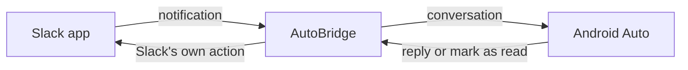

# AutoBridge: Slack Notifications for Android Auto

**Hear Slack messages in your car, reply by voice, and mark them as read.**

[Install](#install) · [Features](#features) · [Settings](#settings) · [Troubleshooting](#troubleshooting) · [FAQ](#faq)

AutoBridge is a free, open-source Android app that brings Slack messages to Android Auto. It shows your Slack DMs and channel notifications on the car screen as Android Auto conversations, so you can listen and reply hands-free.

It runs entirely on your phone. There's no internet permission, Slack login, or API token, and your replies are sent by the Slack app you already use.

> [!NOTE]
> AutoBridge is an unofficial, independent project. It is not affiliated with, endorsed by, or sponsored by Slack Technologies or Google. Slack and Android Auto are trademarks of their respective owners and are used only to describe compatibility.

## Features

| Feature | What you get |
| --- | --- |
| **Slack messages in the car** | Each conversation appears in Android Auto with its sender and DM or channel title. |
| **Voice replies** | Your reply goes through the Slack app and posts as you. |
| **Quick replies** | Pick from canned replies that you can edit. |
| **Mark as read** | Clears the relayed message and tells Slack when Slack offers that action. |
| **Filters** | Limit the relay to DMs or mentions, allow or block channels, and mute keywords. |
| **Multiple workspaces** | Switch each workspace on or off and tell them apart in conversation titles. |
| **Car-only mode** | Relays only while connected to Android Auto, so there are no duplicates the rest of the time. |
| **Stays in sync** | When Slack clears a notification, AutoBridge clears its copy too. |

## Install

**You need:** Android 8.0 or later, Android Auto, and the Slack Android app signed in with notifications on.

### 1. Install the APK

Download the latest `AutoBridge-vX.Y.Z.apk` from [Releases](../../releases), open it on your phone, and allow the install when prompted. If no release is listed yet, [build it from source](CONTRIBUTING.md#build-from-source).

### 2. Grant permissions

Open AutoBridge and tap **Grant** next to **Notification access**, **Post notifications**, and **Battery optimization**.

> [!TIP]
> If Android blocks notification access, open AutoBridge's system info page, tap **⋮ → Allow restricted settings**, and try again.

### 3. Turn on Unknown sources in Android Auto

**This step is required.** Without it, messages appear on your phone but not in the car. Do this on your phone, while parked. Menu names vary by device.

1. Open **Settings → Connected devices → Connection preferences → Android Auto**. On Samsung, open **Settings → Connected devices → Android Auto**.
2. Scroll to **Version**, tap it about 10 times, and accept the prompt to enable developer mode.
3. Tap **⋮ → Developer settings** and turn on **Unknown sources**.
4. Force stop Android Auto and reconnect to the car.

### 4. Test it

While parked and connected, open AutoBridge and tap **Send test message**. It should appear as a notification on the car screen.

AutoBridge doesn't appear in the car's app list. It works through notifications only.

## Settings

| Setting | What it does |
| --- | --- |
| **Relay to Android Auto** | Turns AutoBridge on or off. |
| **Only while connected to Android Auto** | On by default. Turn it off to relay all the time, silently when you're not in the car. |
| **Direct messages only** | Skips channels and group DMs. |
| **Mentions only in channels** | Relays channel messages only if they contain an @name. DMs always pass. |
| **Only these channels** / **Never these channels** | Allows or blocks channels by name. Blocking wins, and group DMs count as channels. |
| **Muted keywords** | Skips messages containing these whole words, in DMs and channels. |
| **Workspaces** | Turns each workspace on or off. A workspace is listed once AutoBridge sees a notification from it, and **Forget detected workspaces** clears the list. |
| **Quick replies** | Sets the replies offered in Android Auto. |

## Troubleshooting

| Problem | What to try |
| --- | --- |
| Messages show on the phone but not in the car | Turn on **Unknown sources**, force stop Android Auto, and reconnect. |
| Nothing relays while connected | Check that the app shows **Android Auto: connected**. If it doesn't, turn off **Only while connected to Android Auto**. |
| A message didn't relay | Check **Diagnostics** in the app, which shows whether a filter blocked it. |
| No relayed notifications at all | Check the status items in the app, and that Slack notifications work on your phone. |
| Messages stop after a while | Exempt AutoBridge from battery optimization. |
| "Your reply wasn't sent" | Slack's reply action expired or is unavailable. A phone notification keeps your reply's text, so you can send it from Slack when parked. |
| No workspace switches or labels | If **workspace name** in **Diagnostics** says `missing`, your Slack version doesn't expose the name. |
| Alerts sound twice while connected | Silence Slack's notifications, or lower AutoBridge's **Relayed messages** channel in system settings. |

**Diagnostics** contains no names or message text, so it's safe to paste into a [bug report](../../issues/new/choose).

## FAQ

### Can I use Slack in Android Auto with this?

Yes, for messages. AutoBridge lets you hear Slack notifications, reply, and mark them as read in the car. It isn't a full Slack app, so you can't browse channels, read history, or start new conversations.

### Is this an official Slack app?

No. AutoBridge is an independent open-source project.

### Do I need a Slack API token or admin approval?

No. AutoBridge reads the notifications Slack posts on your phone and never contacts Slack's servers.

### Can AutoBridge send my messages anywhere?

It doesn't request the `INTERNET` permission, so it has no network access, and CI checks this on every build. Message content stays in memory. See [PRIVACY.md](PRIVACY.md).

### Why isn't it on Google Play?

AutoBridge is currently distributed as an APK on GitHub, which is why Android Auto needs **Unknown sources** turned on.

### Does it support Slack calls or huddles?

No, only messages.

### Does it work with Apple CarPlay or Android Automotive?

No. It's an Android phone app for Android Auto.

## Known limitations

- AutoBridge depends on the format of Slack's notifications, which can change without notice.
- Slack doesn't mark mentions in its notifications, so **Mentions only in channels** also matches mentions of other people.
- A reply can fail if Android has just restarted AutoBridge, because conversations are held in memory. For the same reason, messages you marked as read can reappear silently after a restart if Slack still shows them.
- Avatars appear only when Slack includes them in its notification.
- If Slack clears its notification after you reply, the relayed conversation clears too.

## How it works

AutoBridge reads the notifications Slack posts on your phone, reposts them in the format Android Auto accepts, and hands your actions back to the Slack app.

## Contributing

Bug reports and pull requests are welcome. See [CONTRIBUTING.md](CONTRIBUTING.md) for build, test, and release instructions.

## License

Licensed under the [Apache License 2.0](LICENSE).
